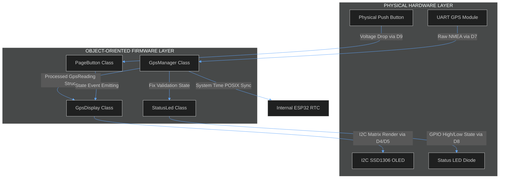
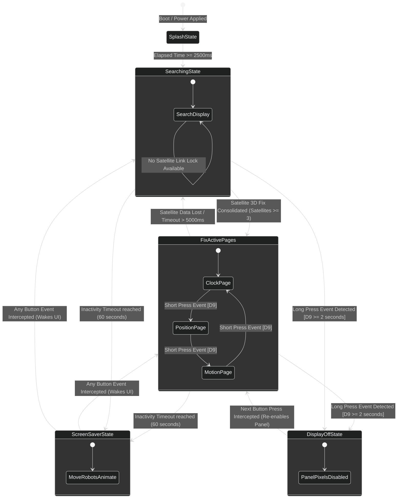

# 🛰️ GPS XIAO ESP32-C6 Embedded Navigation System

## Compilar e gravar sem a IDE — fluxo recomendado

Use `firmware.cmd` ou `make` na pasta do projeto. O fluxo usa Arduino CLI independente,
com pacote ESP32 e bibliotecas em `.arduino/`, sem carregar configurações da
IDE nem alterar `boards.txt` da instalação global. A tabela OTA vem de
`partitions.csv` e o limite de **1.966.080 bytes** é passado explicitamente
na compilação. Não é preciso executar `instalar-particao-ota.ps1` nesse fluxo.

Com GNU Make instalado, os alvos equivalentes são:

```sh
make preparar
make compilar
make portas
make usb PORT=COM5
make ota PORT=192.168.1.50
```

`JOBS` controla o número de tarefas paralelas da compilação (padrão: `2`),
por exemplo `make compilar JOBS=4`. `make` apenas encaminha as ações para
`firmware.ps1`; o Arduino CLI continua sendo localizado em `.tools`, no `PATH`
ou pela variável `ARDUINO_CLI`.

O executável Arduino CLI pode ficar em `.tools/arduino-cli.exe`, no PATH ou
ser informado com `-Cli`. A cópia em `.tools/` é local e não depende de abrir
a IDE. Para obtê-lo novamente, use o
[download oficial do Arduino CLI](https://docs.arduino.cc/arduino-cli/installation/).

No PowerShell, dentro da pasta do projeto:

```powershell
.\firmware.cmd preparar
.\firmware.cmd compilar
.\firmware.cmd portas
.\firmware.cmd usb -Porta COM5
```

Substitua `COM5` pela porta da placa. `preparar` baixa o ESP32 **3.3.12**,
ArduinoJson **7.4.2**, TinyGPSPlus **1.0.3**, Adafruit SSD1306 **2.5.9** e
Adafruit GFX Library **1.11.9**, além das dependências dessas bibliotecas.
É necessário acesso à internet na preparação. As ferramentas e bibliotecas
ficam isoladas no projeto e podem ocupar bastante espaço em disco.
As dependências transitivas seguem a resolução do gerenciador de bibliotecas;
não é uma distribuição totalmente congelada de todas as ferramentas.

O comando `usb` recompila antes de gravar e instala bootloader, tabela de
partições e aplicação. Use-o uma vez para migrar da tabela antiga para as
duas partições OTA de 1.875 MiB. Depois configure o Wi-Fi e atualize sem senha:

```powershell
.\firmware.cmd ota -Porta 192.168.1.50
```

Substitua o IP pelo endereço mostrado na tela REDE WI-FI. O computador precisa
alcançar a placa na rede. O OTA usa a porta 3232 e não instala uma nova tabela
de partições. Tanto `usb` quanto `ota` compilam primeiro e param se a compilação
falhar. Feche o monitor serial antes de gravar por USB.

Os arquivos são gerados em `build-cli/` e copiados para `output/` após sucesso.
`XIAO_ESP32C6.ino.bin` é a aplicação; os arquivos de bootloader e partições
também ficam em `output/`. O script verifica o tamanho do binário gerado.
Esses diretórios, `.arduino/` e `.tools/` ficam fora do controle de versão.

Compilação, gravação e testes ficam por conta do usuário. Criar estes scripts
não significa que um novo firmware binário já foi compilado ou validado.

[](https://platformio.org/)
[](https://www.arduino.cc/)
[](https://www.espressif.com/en/products/socs/esp32-c6)


An advanced, object-oriented embedded firmware designed for the **Seeed Studio XIAO ESP32-C6** dev board. This system ingests raw NMEA data sentences via hardware UART, implements precise Unix/POSIX system clock synchronization through satellite UTC telemetry, and hosts a multi-page interactive UI on an I2C SSD1306 OLED display with aggressive power management and an active screen saver.

---

## 💎 Key Features

*   **⚡ Object-Oriented Architecture:** Completely decoupled, modular codebase containing independent controller classes (`GpsManager`, `GpsDisplay`, `PageButton`, and `StatusLed`) for high maintainability.
*   **⏰ POSIX Real-Time Synchronization:** Synchronizes the internal ESP32 hardware RTC to atomic satellite UTC time every 60 seconds, handling standard and Daylight Saving Time (DST) zone configurations.
*   **📡 Smart NMEA Diagnostic Echo:** Streams raw unparsed NMEA sentences directly to the serial terminal during initial satellite search. It halts smoothly without slicing strings the exact moment a reliable 3D positional fix is locked.
*   **🎮 Premium UI/UX Ecosystem:**
    *   **Data Paging:** Multi-view screens rendering real-time local time/date, coordinate matrices (Latitude/Longitude with 6 decimal places), speed over ground, cardinal headings, and precise HDOP tracking.
    *   **Screen Saver:** An algorithmically animated matrix drawing custom robot faces displaying randomized micro-expressions (blinking, smiling, looking sideways) to eliminate pixel burn-in.
    *   **Display Dimming & Wake:** Hardware interrupt button logic to manually disable the screen completely without freezing background telemetry parsing.

---

## 📐 Hardware Architecture & Electrical Design

### Technical Pinout Configuration

| Pino XIAO ESP32-C6 | Função | Periférico | Descrição Operacional |
|-------------------|---------|------------|-----------------------|
| D4 (GPIO22) | I²C SDA | OLED SSD1306 SDA | Linha de dados (SDA) do barramento I²C. |
| D5 (GPIO23) | I²C SCL | OLED SSD1306 SCL | Linha de clock (SCL) do barramento I²C. |
| D6 (GPIO21) | UART1 TX | GPS RX | Transmissão de dados seriais para o receptor GPS. |
| D7 (GPIO20) | UART1 RX | GPS TX | Recepção das sentenças NMEA do receptor GPS (9600 baud). |
| D8 (GPIO19) | Saída Digital | LED de Status Externo | Pisca a cada 500 ms durante a busca por satélites e permanece aceso quando há fixação GPS. |
| D9 (GPIO18) | Entrada Digital | Botão Tátil | Entrada com debounce para navegação, despertar e controle de modos de operação. |

### ⚡ Electrical Engineering & Ballast Component Math

#### 1. Status LED Current-Limiting Resistor Optimization
To prevent thermal runaway on the external status LED driven by the `D8` digital output pin, a ballast resistor ($R_{LED}$) must be placed in series. The output high voltage ($V_{OH}$) of the ESP32-C6 GPIO pin is $3.3\text{ V}$.

Assuming a standard **High-Efficiency Red LED** with a forward voltage drop ($V_f$) of $2.0\text{ V}$ and a safe targeted forward operating current ($I_f$) of $10\text{ mA}$ ($0.01\text{ A}$):

$$\text{Ohm's Law: } R = \frac{V_{OH} - V_f}{I_f}$$

$$R_{LED} = \frac{3.3\text{ V} - 2.0\text{ V}}{0.01\text{ A}} = \frac{1.3\text{ V}}{0.01\text{ A}} = 130\ \Omega$$

*Recommended E12 standard resistor value:* **$150\ \Omega$** (This slightly decreases current to $\approx 8.6\text{ mA}$, extending component lifetime while guaranteeing strong luminosity).

#### 2. Input Button Safety Integration
The tactile button attached to `D9` references an active-low switching topology. The microcontroller pin is initialized with an internal pull-up resistor ($R_{PU} \approx 45\ \text{k}\Omega$). When the button is unpressed, the input floats safely to $3.3\text{ V}$ (Logic High). When depressed, it grounds the line directly ($0\text{ V}$, Logic Low). No external pull-up components are required, saving physical PCB space.
## 📊 System Workflows & Logical Diagrams

### 1. Overall System Block Architecture



#### Step-by-Step Architectural Flow
1. **Telemetry Capture:** The physical GPS module continuously transmits NMEA data streams to the `GpsManager` instance via hardware UART.
2. **Data Parsing & System Update:** `GpsManager` decodes strings using TinyGPS++. If the coordinates and clock dates match accuracy parameters, it triggers standard UNIX time updates directly into the ESP32 Core OS clock environment.
3. **Event Generation:** The `PageButton` class samples physical fluctuations on pin `D9`, filters out high-frequency contact bouncing, and forwards valid actions to `GpsDisplay`.
4. **UI Update & Execution:** `GpsDisplay` consumes structural information from `GpsManager` and structural clicks from `PageButton` to refresh the graphical screens over the I2C bus. Concurrently, `StatusLed` modulates the hardware LED state according to satellite availability.

---

### 2. Main Software Execution Loop (`setup` & `loop`)


#### Step-by-Step Execution Flow
1. **Boot Vector:** On microcontroller power injection, CPU initializes primary diagnostic serial lines at `115200` baud.
2. **I2C Identification:** The software runs a fast hardware scan over standard I2C slots (`0x3C`/`0x3D`) to confirm the display panel is alive before assigning display parameters.
3. **Asynchronous Byte Engine:** Inside the non-blocking infinite `loop()`, incoming bytes on the serial receiver buffer are inspected. If characters exist, they pass to the parsing compiler.
4. **State-Driven Echo:** If the satellite link indicates a low satellite count ($N < 3$), characters route instantly out to the diagnostic serial interface. Once a link stabilizes, output stops cleanly without breaking current sentences.
5. **Periodic System Maintenance:** Once the input buffers empty, the system checks for button events, updates the display matrix at a constrained refresh step ($250\text{ ms}$), and toggles the LED.
### 3. Display Interface State Machine (UI Controller)



#### Step-by-Step UI State Transitions
1. **Initialization:** The UI enters `SplashState` for $2500\text{ ms}$, flashing the project logo and filling an asset loading bar.
2. **Unfixed Search Handling:** The UI steps down to `SearchingState`. It displays active running durations alongside calculated available satellite feeds.
3. **Data Page Carousel:** When accurate positional links stabilize, users cycle sequentially between pages via quick clicks: `ClockPage` $\rightarrow$ `PositionPage` $\rightarrow$ `MotionPage` $\rightarrow$ `ClockPage`.
4. **Active Burn-in Shield:** If no interaction happens on the button for $60$ seconds, the display shifts to `ScreenSaverState`. It paints procedural vectors across the panel coordinates to keep the organic LEDs from degrading unevenly.
5. **Total Pixel Blanking:** Holding down the control switch for $\ge 2$ seconds cuts screen emissions entirely via programmatic command overrides (`SSD1306_DISPLAYOFF`). Telemetry engines stay active in memory.

---

### 4. POSIX Chronological Sync Engine Latching Flow


#### Step-by-Step Clock Synchronization Flow
1. **Throttling Guard:** On successful sentence reception, the logic verifies that the scheduling window has elapsed ($T > 60\text{ s}$) to prevent over-allocating internal processor clock updates.
2. **Data Integrity Inspection:** The core parses time indicators. If satellite data fields display transmission corruption flags, processing breaks immediately.
3. **Latency Verification:** The system reads the update interval age. If the communication delay stretches above $1000\text{ ms}$, the time is discarded to preserve absolute clock synchronization.
4. **Epoch Conversion Engine:** Gregorian timestamp parameters parse into pure cumulative elapsed seconds counting forward from the standardized January 1, 1970 UNIX Epoch baseline.
5. **System Core Integration:** The calculated value structures pass down into the operating system core using standard low-level POSIX functions (`settimeofday()`). The internal clock is now synchronized to satellite precision.

---

## 🚀 Getting Started

### Project Directory Layout

```bash
├── include/
│   ├── GpsDisplay.h    # OLED visualization engine definitions
│   ├── GpsManager.h    # TinyGPS++ parsing wrapper & POSIX clock alignment
│   ├── PageButton.h    # Debounced state tracking for tactile inputs
│   └── StatusLed.h     # High-efficiency status LED controller
└── src/
    ├── GpsDisplay.cpp  # Implementation of UI frames, screensaver, & graphics
    ├── GpsManager.cpp  # UTC adjustments, zone translation, & text reporting
    ├── StatusLed.cpp   # Implementation of LED blink algorithms
    └── main.ino        # Principal system setup and cyclical loop execution
```

### Compilation Quickstart (PlatformIO)

Add this baseline environments file configuration to your local `platformio.ini` project root file before initiating verification compilations:

```ini
[env:seeed_xiao_esp32c6]
platform = espressif32
board = seeed_xiao_esp32c6
framework = arduino
monitor_speed = 115200
board_build.partitions = partitions.csv
lib_deps =
    bblanchon/ArduinoJson @ ^7
    mikalhart/TinyGPSPlus @ ^1.0.3
    adafruit/Adafruit SSD1306 @ ^2.5.9
    adafruit/Adafruit GFX Library @ ^1.11.9
```

---

## 📄 License

This project is licensed under the MIT License - see the [LICENSE](LICENSE) file for details.

## Configuração de Wi-Fi

### Posição, localidade e previsão na página web

As páginas `/` e `/config` mostram posição GPS, número de satélites, precisão
HDOP e localidade (cidade, estado e país), além do formulário Wi-Fi.
O painel atualiza automaticamente a cada três segundos por `/api/posicao`,
sem recarregar o formulário nem apagar os campos digitados.
Coordenadas e link para o OpenStreetMap só aparecem com posição confiável.
Se faltar comunicação com a placa, o painel identifica os dados como possivelmente
desatualizados. O mapa só é aberto quando o usuário clica no link.

Manter a página aberta também habilita as consultas de localidade e de previsão,
mesmo com o OLED apagado ou em outra tela. As consultas deixam de ser solicitadas
15 segundos após a última atualização web, salvo quando a tela correspondente
estiver ativa no OLED. Os dados de posição ficam acessíveis aos dispositivos
com acesso à página web na rede da placa.

### Previsão do tempo

A tela **PREVISAO DO TEMPO**, depois de **LOCALIDADE**, mostra três dias de
previsão para as coordenadas GPS. Alterna o dia exibido a cada cinco segundos,
com data, condição, mínima e máxima em °C e probabilidade diária de chuva.
A página web mostra os três dias juntos e a idade da consulta.

Fonte: [Open-Meteo](https://open-meteo.com/en/docs), sem chave no endpoint público.
As coordenadas atuais são enviadas por HTTPS ao serviço. As datas usam o fuso
da posição (`timezone=auto`); não há cidade fixa configurada no firmware.
A previsão usa as coordenadas diretamente e independe do sucesso da consulta
do nome da localidade. Requer posição confiável, Wi-Fi com internet e hora GPS
sincronizada para validar os certificados HTTPS.

Resultados são reaproveitados por 30 minutos enquanto o deslocamento for
inferior a 5 km. Há intervalo mínimo de cinco minutos entre tentativas.
Sem rede ou GPS, após falha, vencimento do cache ou deslocamento, os dados
armazenados são identificados como anteriores. As consultas de tempo e
localidade são feitas em tarefas separadas, uma por vez, para manter o GPS
ativo e reduzir o consumo simultâneo de memória pelas conexões HTTPS.

### Página de localidade no OLED

A página **LOCALIDADE**, após **REDE WI-FI** na navegação pelo botão D9,
consulta as coordenadas atuais e mostra cidade/localidade, estado e país.
Nomes longos rolam horizontalmente; acentos portugueses são simplificados
para a fonte do OLED.

A consulta ocorre com essa tela ativa ou com a página web aberta, posição GPS confiável,
hora de sistema sincronizada e Wi-Fi com acesso à internet. A requisição
HTTPS é processada em tarefa separada para manter a leitura GPS ativa.
O resultado fica em memória enquanto o deslocamento for inferior a 500 m;
há um intervalo mínimo de um minuto entre tentativas, inclusive após erros.
Sem rede ou posição válida, a tela informa a condição e identifica o resultado
armazenado como **Consulta anterior**. Os nomes são aproximados, conforme
a cobertura do serviço, e não representam um endereço exato.

Fonte: [BigDataCloud Reverse Geocoding](https://www.bigdatacloud.com/docs/article/why-is-reverse-geocoding-api-free).
Ao abrir essa tela com os requisitos atendidos, a placa envia sua latitude e
longitude atuais ao BigDataCloud; o serviço também recebe o IP de origem.
O endpoint cliente não exige chave. O provedor pode alterar disponibilidade
e limites de uso.

Dependência adicional: **ArduinoJson 7**, instalável pelo Gerenciador de
Bibliotecas da IDE. A conexão segura usa o pacote de certificados integrado
do ESP32 3.3.12 (`useBuiltinCACertBundle`) e a hora sincronizada pelo GPS.
Não há consulta por IP como substituto da posição GPS.

### Página de rede no OLED

Um toque curto no botão D9 avança até a página **REDE WI-FI**, disponível
também durante a busca de satélites e quando não há dados do GPS.
Ela mostra o estado da conexão, SSID, endereço IP e sinal em dBm quando
conectado. No modo de configuração, mostra a rede **XIAO_ESP32C6_CONFIG**,
o IP do portal e a indicação para abrir `/config` no navegador.
Nomes de rede longos são limitados à largura do display.
A proteção de tela e o desligamento pelo botão continuam funcionando.

### Cadastro das redes

O firmware inclui uma página no mesmo estilo do M5NanoC6, com até cinco redes
salvas na memória da placa. Usa as bibliotecas WiFi, WebServer e Preferences
incluídas no pacote Arduino ESP32.

1. Na primeira inicialização, conecte o celular ou computador à rede aberta
   **XIAO_ESP32C6_CONFIG**.
2. Abra **http://192.168.4.1/config** no navegador.
3. Preencha as redes e clique em **Salvar e Reiniciar**.

SSID vazio remove a rede. Senha vazia preserva a senha anterior quando o SSID
permanece igual no mesmo campo; para uma rede nova, indica rede sem senha.
As senhas salvas nunca são exibidas na página.

A placa tenta cada rede cadastrada na ordem dos campos, com até 13 segundos por
rede. Se nenhuma conectar, abre a rede de configuração e tenta novamente a cada
10 minutos. Quando conecta, desliga a rede de configuração; a página continua
acessível em **http://IP_DA_PLACA/config** (IP informado no monitor serial a
115200 baud). Se perder a conexão, reabre a rede de configuração.

GPS, LED, botão e OLED continuam sendo atendidos durante as tentativas de conexão.
Salvar reinicia a placa e exige nova sincronização de hora pelo GPS.
A configuração é acessível a quem estiver conectado à rede local ou à rede aberta
da placa.

## Atualização OTA pela IDE do Arduino (sem senha)

Este é um caminho opcional. Para independência da IDE e de seus menus, use
o fluxo `firmware.cmd` descrito no início deste documento.

O firmware usa a biblioteca ArduinoOTA incluída no pacote Arduino ESP32.
Após conectar a uma rede Wi-Fi cadastrada, anuncia a porta de rede
**xiao-esp32c6** por mDNS, sem senha de upload. O serviço é reiniciado
automaticamente após uma queda e recuperação da conexão Wi-Fi.

1. Grave esta versão inicialmente por USB e configure o Wi-Fi.
2. Conecte o computador à mesma rede da placa.
3. Na IDE do Arduino, mantenha a placa **XIAO_ESP32C6** selecionada e, em
   **Ferramentas > Partition Scheme**, use
   **GPS OTA 4MB (1.875MB x2 / 128KB SPIFFS)**, instalada pelo script abaixo.
   A tabela `partitions.csv` do projeto contém `otadata`, `ota_0` e `ota_1`,
   com 1.966.080 bytes por aplicação. O padrão de 1.310.720 bytes ficou pequeno
   após a inclusão das consultas HTTPS e da previsão do tempo.
   As opções **No OTA** e **Huge APP** não servem para essa atualização.
4. Em **Ferramentas > Porta**, selecione a porta de rede **xiao-esp32c6**
   associada ao IP da placa e carregue o sketch normalmente, sem senha.

A descoberta depende de mDNS na rede local; isolamento de clientes ou firewall
pode impedir que a porta apareça. O monitor serial informa quando o serviço
está disponível, quando a atualização inicia e eventuais erros.
A placa reinicia após concluir o upload. Durante a transferência, a rotina
ArduinoOTA pode pausar temporariamente o processamento do GPS e do display.
O OTA fica disponível quando conectado a uma rede cadastrada; a rede de
configuração continua destinada ao cadastro de Wi-Fi.

Compilação e testes na IDE e na placa ficam a cargo do usuário.

### Instalação da opção de partições na IDE

Execute `powershell -ExecutionPolicy Bypass -File .\instalar-particao-ota.ps1`
na pasta do projeto. O script instala a tabela no pacote ESP32 3.3.12 e adiciona
uma opção específica em `boards.local.txt`, preservando as demais opções.
Também ajusta a opção `default` da XIAO_ESP32C6 em `boards.txt` para usar
a mesma tabela OTA e o limite de 1.966.080 bytes. Preserva uma cópia em
`boards.txt.before-xiao-gps-ota.bak`. Esse novo padrão vale também para outros
sketches que selecionem essa placa e essa opção no pacote instalado.
Ao atualizar o pacote ESP32, execute novamente com `-Esp32Package` apontando
para a nova pasta da versão. Reinicie a IDE para atualizar o menu.

Se a opção GPS OTA não aparecer, feche **todas** as janelas da IDE Arduino e
abra novamente. Abrir apenas o menu ou outra janela pode manter a lista antiga
carregada. Confirme que a placa selecionada é XIAO_ESP32C6 e que a versão do
pacote ESP32 corresponde à pasta usada pelo instalador.
Se ainda houver a lista antiga, salve o sketch e encerre todas as janelas da
IDE. No Gerenciador de Tarefas, confira se restou `arduino-cli.exe` da IDE e
encerre esse processo antes de reabrir. A IDE mantém as definições de placa
carregadas em seu serviço; uma consulta nova do Arduino CLI já reconheceu
`build.partitions=xiao_gps_ota` e `upload.maximum_size=1966080` nesta instalação.

Selecione **GPS OTA 4MB (1.875MB x2 / 128KB SPIFFS)** e grave novamente por
**USB**, mesmo se já usava OTA: a atualização pela rede não troca a tabela
de partições. Depois dessa gravação, volte a usar a porta de rede.
A flash continua em 4 MB; o SPIFFS diminui para 128 KiB, sem uso pelo firmware
atual. A região NVS das credenciais Wi-Fi mantém endereço e tamanho.

Com os 1.388.942 bytes informados na compilação, o novo limite deixa 577.138
bytes livres por aplicação (aproximadamente 71% ocupados). Essa comparação
não substitui nova compilação e validação pelo usuário.
