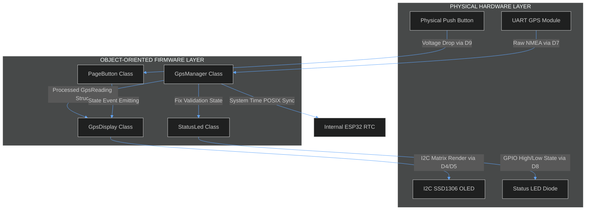
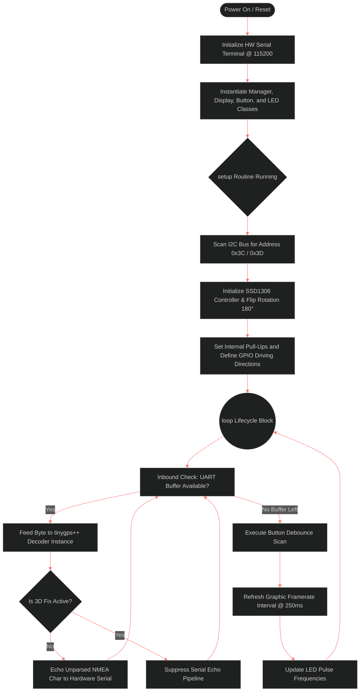
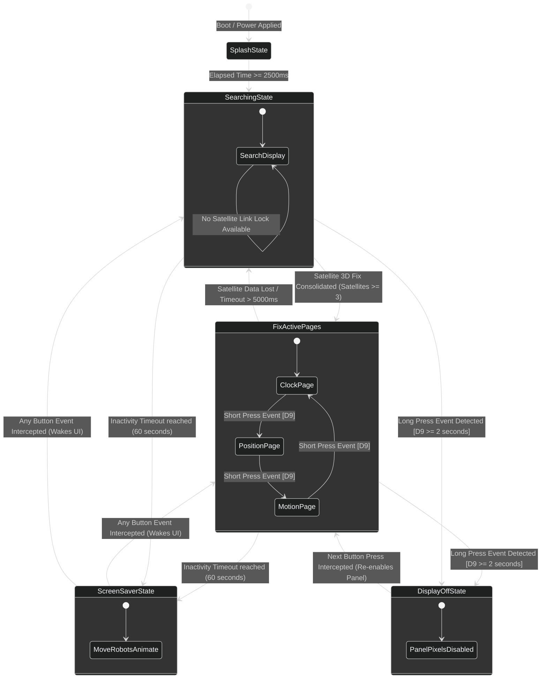
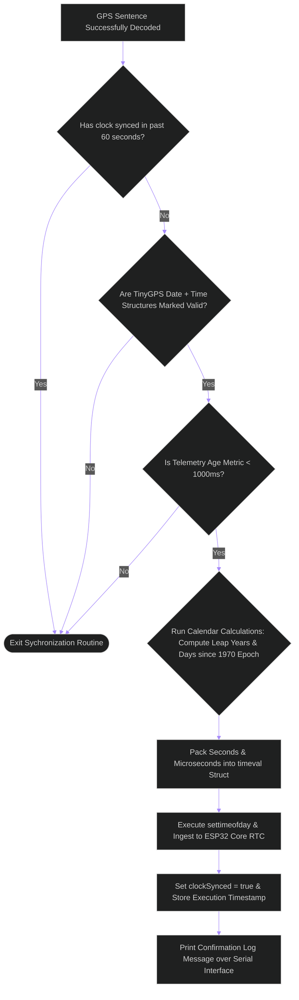

# 🛰️ GPS XIAO ESP32-C6 Embedded Navigation System


An advanced, object-oriented embedded firmware designed for the **Seeed Studio XIAO ESP32-C6** dev board. This system ingests raw NMEA data sentences via hardware UART, implements precise Unix/POSIX system clock synchronization through satellite UTC telemetry, and hosts a multi-page interactive UI on an I2C SSD1306 OLED display with aggressive power management and an active screen saver.

---

## 💎 Key Features

*   **⚡ Object-Oriented Architecture:** Completely decoupled, modular codebase containing independent controller classes (`GpsManager`, `GpsDisplay`, `PageButton`, and `StatusLed`) for high maintainability.
*   **⏰ POSIX Real-Time Synchronization:** Synchronizes the internal ESP32 hardware RTC to atomic satellite UTC time every 60 seconds, handling standard and Daylight Saving Time (DST) zone configurations.
*   **📡 Smart NMEA Diagnostic Echo:** Streams raw unparsed NMEA sentences directly to the serial terminal during initial satellite search. It halts smoothly without slicing strings the exact moment a reliable 3D positional fix is locked.
*   **🎮 Premium UI/UX Ecosystem:**
    *   **Data Paging:** Multi-view screens rendering real-time local time/date, coordinate matrices (Latitude/Longitude with 6 decimal places), speed over ground, cardinal headings, and precise HDOP tracking.
    *   **Screen Saver:** An algorithmically animated matrix drawing custom robot faces displaying randomized micro-expressions (blinking, smiling, looking sideways) to eliminate pixel burn-in.
    *   **Display Dimming & Wake:** Hardware interrupt button logic to manually disable the screen completely without freezing background telemetry parsing.

---

## 📐 Hardware Architecture & Electrical Design

### Technical Pinout Configuration

| Pino XIAO ESP32-C6 | Função | Periférico | Descrição Operacional |
|-------------------|---------|------------|-----------------------|
| D4 (GPIO22) | I²C SDA | OLED SSD1306 SDA | Linha de dados (SDA) do barramento I²C. |
| D5 (GPIO23) | I²C SCL | OLED SSD1306 SCL | Linha de clock (SCL) do barramento I²C. |
| D6 (GPIO21) | UART1 TX | GPS RX | Transmissão de dados seriais para o receptor GPS. |
| D7 (GPIO20) | UART1 RX | GPS TX | Recepção das sentenças NMEA do receptor GPS (9600 baud). |
| D8 (GPIO19) | Saída Digital | LED de Status Externo | Pisca a cada 500 ms durante a busca por satélites e permanece aceso quando há fixação GPS. |
| D9 (GPIO18) | Entrada Digital | Botão Tátil | Entrada com debounce para navegação, despertar e controle de modos de operação. |

### ⚡ Electrical Engineering & Ballast Component Math

#### 1. Status LED Current-Limiting Resistor Optimization
To prevent thermal runaway on the external status LED driven by the `D8` digital output pin, a ballast resistor ($R_{LED}$) must be placed in series. The output high voltage ($V_{OH}$) of the ESP32-C6 GPIO pin is $3.3\text{ V}$.

Assuming a standard **High-Efficiency Red LED** with a forward voltage drop ($V_f$) of $2.0\text{ V}$ and a safe targeted forward operating current ($I_f$) of $10\text{ mA}$ ($0.01\text{ A}$):

$$\text{Ohm's Law: } R = \frac{V_{OH} - V_f}{I_f}$$

$$R_{LED} = \frac{3.3\text{ V} - 2.0\text{ V}}{0.01\text{ A}} = \frac{1.3\text{ V}}{0.01\text{ A}} = 130\ \Omega$$

*Recommended E12 standard resistor value:* **$150\ \Omega$** (This slightly decreases current to $\approx 8.6\text{ mA}$, extending component lifetime while guaranteeing strong luminosity).

#### 2. Input Button Safety Integration
The tactile button attached to `D9` references an active-low switching topology. The microcontroller pin is initialized with an internal pull-up resistor ($R_{PU} \approx 45\ \text{k}\Omega$). When the button is unpressed, the input floats safely to $3.3\text{ V}$ (Logic High). When depressed, it grounds the line directly ($0\text{ V}$, Logic Low). No external pull-up components are required, saving physical PCB space.
## 📊 System Workflows & Logical Diagrams

### 1. Overall System Block Architecture



#### Step-by-Step Architectural Flow
1. **Telemetry Capture:** The physical GPS module continuously transmits NMEA data streams to the `GpsManager` instance via hardware UART.
2. **Data Parsing & System Update:** `GpsManager` decodes strings using TinyGPS++. If the coordinates and clock dates match accuracy parameters, it triggers standard UNIX time updates directly into the ESP32 Core OS clock environment.
3. **Event Generation:** The `PageButton` class samples physical fluctuations on pin `D9`, filters out high-frequency contact bouncing, and forwards valid actions to `GpsDisplay`.
4. **UI Update & Execution:** `GpsDisplay` consumes structural information from `GpsManager` and structural clicks from `PageButton` to refresh the graphical screens over the I2C bus. Concurrently, `StatusLed` modulates the hardware LED state according to satellite availability.

---

### 2. Main Software Execution Loop (`setup` & `loop`)



#### Step-by-Step Execution Flow
1. **Boot Vector:** On microcontroller power injection, CPU initializes primary diagnostic serial lines at `115200` baud.
2. **I2C Identification:** The software runs a fast hardware scan over standard I2C slots (`0x3C`/`0x3D`) to confirm the display panel is alive before assigning display parameters.
3. **Asynchronous Byte Engine:** Inside the non-blocking infinite `loop()`, incoming bytes on the serial receiver buffer are inspected. If characters exist, they pass to the parsing compiler.
4. **State-Driven Echo:** If the satellite link indicates a low satellite count ($N < 3$), characters route instantly out to the diagnostic serial interface. Once a link stabilizes, output stops cleanly without breaking current sentences.
5. **Periodic System Maintenance:** Once the input buffers empty, the system checks for button events, updates the display matrix at a constrained refresh step ($250\text{ ms}$), and toggles the LED.
### 3. Display Interface State Machine (UI Controller)



#### Step-by-Step UI State Transitions
1. **Initialization:** The UI enters `SplashState` for $2500\text{ ms}$, flashing the project logo and filling an asset loading bar.
2. **Unfixed Search Handling:** The UI steps down to `SearchingState`. It displays active running durations alongside calculated available satellite feeds.
3. **Data Page Carousel:** When accurate positional links stabilize, users cycle sequentially between pages via quick clicks: `ClockPage` $\rightarrow$ `PositionPage` $\rightarrow$ `MotionPage` $\rightarrow$ `ClockPage`.
4. **Active Burn-in Shield:** If no interaction happens on the button for $60$ seconds, the display shifts to `ScreenSaverState`. It paints procedural vectors across the panel coordinates to keep the organic LEDs from degrading unevenly.
5. **Total Pixel Blanking:** Holding down the control switch for $\ge 2$ seconds cuts screen emissions entirely via programmatic command overrides (`SSD1306_DISPLAYOFF`). Telemetry engines stay active in memory.

---

### 4. POSIX Chronological Sync Engine Latching Flow



#### Step-by-Step Clock Synchronization Flow
1. **Throttling Guard:** On successful sentence reception, the logic verifies that the scheduling window has elapsed ($T > 60\text{ s}$) to prevent over-allocating internal processor clock updates.
2. **Data Integrity Inspection:** The core parses time indicators. If satellite data fields display transmission corruption flags, processing breaks immediately.
3. **Latency Verification:** The system reads the update interval age. If the communication delay stretches above $1000\text{ ms}$, the time is discarded to preserve absolute clock synchronization.
4. **Epoch Conversion Engine:** Gregorian timestamp parameters parse into pure cumulative elapsed seconds counting forward from the standardized January 1, 1970 UNIX Epoch baseline.
5. **System Core Integration:** The calculated value structures pass down into the operating system core using standard low-level POSIX functions (`settimeofday()`). The internal clock is now synchronized to satellite precision.

---

## 🚀 Getting Started

### Project Directory Layout

```bash
├── include/
│   ├── GpsDisplay.h    # OLED visualization engine definitions
│   ├── GpsManager.h    # TinyGPS++ parsing wrapper & POSIX clock alignment
│   ├── PageButton.h    # Debounced state tracking for tactile inputs
│   └── StatusLed.h     # High-efficiency status LED controller
└── src/
    ├── GpsDisplay.cpp  # Implementation of UI frames, screensaver, & graphics
    ├── GpsManager.cpp  # UTC adjustments, zone translation, & text reporting
    ├── StatusLed.cpp   # Implementation of LED blink algorithms
    └── main.ino        # Principal system setup and cyclical loop execution
```

### Compilation Quickstart (PlatformIO)

Add this baseline environments file configuration to your local `platformio.ini` project root file before initiating verification compilations:

```ini
[env:seeed_xiao_esp32c6]
platform = espressif32
board = seeed_xiao_esp32c6
framework = arduino
monitor_speed = 115200
lib_deps =
    mikalhart/TinyGPSPlus @ ^1.0.3
    adafruit/Adafruit SSD1306 @ ^2.5.9
    adafruit/Adafruit GFX Library @ ^1.11.9
```

---

## 📄 License

This project is licensed under the MIT License - see the [LICENSE](LICENSE) file for details.
